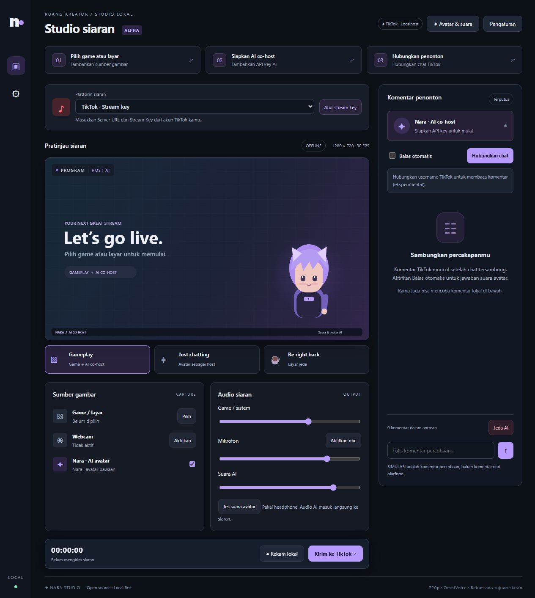

# Nara Studio

An open-source, local livestream studio for gameplay, AI avatars, and viewer interaction. Built with Node.js, browser Canvas/Web Audio, and FFmpeg. No OBS installation required.

**Status: experimental alpha.** Windows is the primary target. Requires Node.js 22+ and Chrome or Microsoft Edge. This is a local server application, not a static website or an offline portable executable.



## Features

- Screen/game capture, webcam, microphone, audio mixing, and local WebM recording.
- AI co-host powered by DeepSeek, Kimi/Moonshot, or OpenAI using your own API key.
- Windows speech or local OmniVoice, with audio-driven lip sync for the built-in avatar or custom PNG characters.
- YouTube account connection, broadcast selection, and live chat after one-time Google Cloud setup.
- Read-only Twitch chat using a channel username.
- Experimental TikTok chat reading through a separate local browser window, without Euler Stream or a chat API key.
- RTMP/RTMPS output for YouTube, TikTok, Twitch, Facebook Live, Kick, and custom destinations. One destination at a time.

AI replies are spoken by the avatar and mixed into the broadcast. The application does not post text replies to platform chats.

## Quick start

Install Node.js 22+ and Chrome or Microsoft Edge, then run:

```powershell
git clone https://github.com/belimbingwuluh78-maker/nara-studio.git
cd nara-studio
npm ci
npm start
```

Open **http://localhost:3210**. On Windows, you can also run `start-studio.cmd`. The first installation downloads dependencies and FFmpeg. Keep the server terminal open while using the studio.

1. Select a game/window and configure your avatar and audio.
2. Open **Settings**, enter your AI API key, and choose a model and persona.
3. Select a platform and click **Connect chat**.
4. Enable **Auto-reply** after chat and voice are ready.
5. Configure the platform's server URL and stream key when you want to send video/audio. Connecting chat alone does not start a broadcast.

The interface, setup guides, and built-in messages are in English. The default AI persona and voice language are English. You can change the persona and OmniVoice language in Settings and Avatar & voice; existing saved voice preferences are preserved. See the [detailed user guide](docs/USER-GUIDE.md) for additional setup instructions.

## TikTok local browser reader

Enter the username of a publicly accessible account that is currently LIVE. Nara opens a separate Edge window, with Chrome as a fallback. Keep that window open. Complete any TikTok login or CAPTCHA yourself if requested.

The reader uses a temporary browser session and does not reuse your personal browser profile or save the session for future runs. Browser audio is muted to avoid feeding the livestream back into your game capture. Disconnecting chat closes the studio-owned browser window.

**This integration is unofficial and experimental.** It reads recognizable comments rendered on the page. TikTok layout changes, verification prompts, and rapidly scrolling chat can prevent reading or cause missed comments. Username-only access is not guaranteed for every account. No signing service is used.

## Voice and avatar options

Windows speech is available without downloading an AI voice model. For OmniVoice:

1. Install [uv](https://docs.astral.sh/uv/getting-started/installation/).
2. Run `setup-omnivoice.ps1` from PowerShell.
3. Open **Avatar & voice**, select OmniVoice, and load the model.

Python, PyTorch, and model downloads require several GB of storage. CPU/GPU resource requirements depend on the selected settings and concurrent game workload. Model weights and runtimes are not included in this repository.

Custom PNG avatars support idle, talking, and optional blink images, plus size/position controls. Live2D/VRM rigging and automatic game-screen understanding are not implemented.

## YouTube setup

Create a Google Cloud project, enable YouTube Data API v3, configure OAuth consent, and create a Web application OAuth client. Register this default redirect URI:

```text
http://localhost:3210/oauth/callback
```

Import the downloaded client JSON through **Google setup** in the studio. Never commit real OAuth credentials, tokens, API keys, cookies, or stream keys.

## Development and testing

```powershell
npm ci
npm run check
npm test
```

The test suite does not require platform accounts, paid AI API keys, or OmniVoice weights. It covers local API validation, chat parsing and lifecycle handling, DOM fixtures, Windows WAV speech, and real FFmpeg conversion. Browser reader tests use fixtures and mocks; they do not establish a real TikTok LIVE connection.

**Verification status:** 21 local automated tests passed on the development Windows machine. Browser launch/close behavior and desktop/narrow-screen layouts were checked. Reading comments from the user's actual TikTok LIVE and the complete real-viewer → paid AI → voice → public broadcast flow have not been verified. Long-running stability and memory usage with games have not been benchmarked; the application is not proven lighter than OBS.

A Windows GitHub Actions workflow is included. Its remote result must be checked separately after it runs.

## Project structure

| Path | Purpose |
| --- | --- |
| `server.mjs` | Local API, OAuth, AI, voice, and encoder relay |
| `public/` | Studio interface, canvas, audio mixer, and avatar controls |
| `live-chat.mjs`, `chat-worker.mjs` | Chat lifecycle and worker isolation |
| `tiktok-browser.mjs`, `tiktok-dom.mjs` | Local browser lifecycle and rendered-comment reader |
| `voice-engine.mjs`, `omnivoice-worker.py` | Local OmniVoice integration |
| `test/` | Automated tests and fixtures |

## Privacy and contribution

API keys and stream keys are kept in server memory. Imported Google client configuration and voice settings/reference audio are stored locally in the ignored `data/` directory. Custom PNG assets stay in the studio browser's local storage/IndexedDB. Do not expose the localhost server directly to the internet.

See [contributing](CONTRIBUTING.md), [security](SECURITY.md), and [third-party notices](THIRD-PARTY-NOTICES.md).

## License

Original application code is released under the [MIT License](LICENSE). Dependencies, FFmpeg binaries, and AI models retain their own licenses. This project is not affiliated with the streaming platforms or AI providers it supports.
